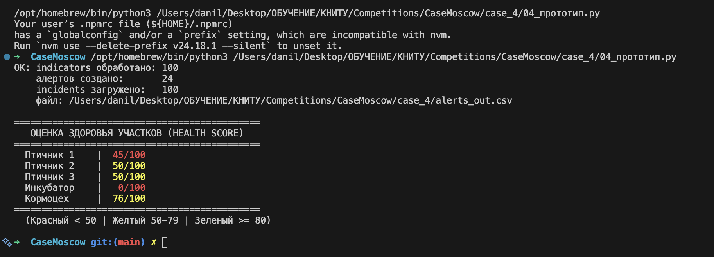
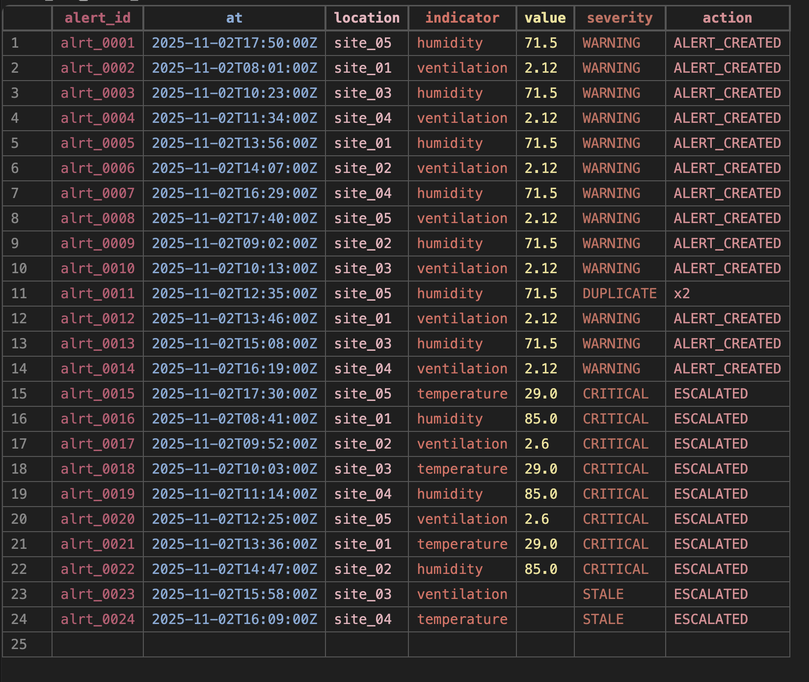
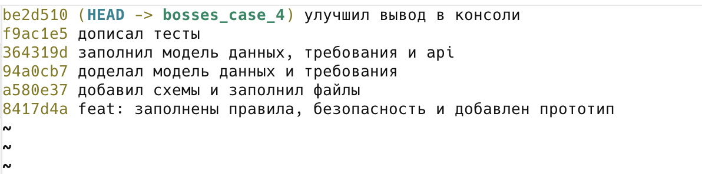

# Приложение — кейс 4

## A. Диаграммы

### A.1. Схема системы (обязательно)

5–6 блоков: Датчики → Ingestion → Rules Engine → Alert → Incident → Диспетчер.
Стрелки — потоки данных. Подписи: JSON-событие, алерт, статус.

### A.2. ER-модель (если делаете 08\_ER.md)

5+ сущностей: Site, Sensor, Measurement, Incident, Alert, AuditEvent.

### A.3. Жизненный цикл инцидента

NEW ──assign──► ASSIGNED ──start──► IN\_PROGRESS ──resolve──► CLOSED
│
└──false-alarm──► CLOSED (NO\_ACTION)

Запрещено: NEW → CLOSED, CLOSED → любой.

### A.4. Схема потоков данных

Датчики → Ingestion → Rules Engine → Alert → авто-инцидент
↓
Мобильное приложение → Incident API → Lifecycle → Assignment
↓
AuditEvent

## B. Таблицы

### B.1. Правила оповещений (A-1…A-5)

|ID|Условие|Действие|severity|
|-|-|-|-|
|A-1|value < norm_min или value > norm_max|создать алерт|WARNING|
|A-2|отклонение > 10% от нормы|эскалировать|CRITICAL|
|A-3|2 подряд CRITICAL по одному датчику в окне 15 мин|создать автоинцидент|CRITICAL|
|A-4|нет данных > 5 мин|создать алерт STALE и эскалировать|STALE|
|A-5|дубль события в окне 5 мин|увеличить счетчик (xN)|DUPLICATE|

### B.2. Формула severity

Если 0 < deviation_pct ≤ 5: severity = WARNING (низкий)
Если 5 < deviation_pct ≤ 10: severity = WARNING (высокий)
Если deviation_pct > 10: severity = CRITICAL
Если value = "" или нет данных: severity = STALE
Если norm_min ≤ value ≤ norm_max: severity = NORMAL

Пример расчёта:
28.3°C при norm_max=26.0 → deviation = (28.3-26)/26 × 100 = 8.8% → WARNING.

### B.3. SLA

|severity|Реакция|Закрытие|Просрочка|
|-|-|-|-|
|CRITICAL|15 мин|1 ч|эскалация руководителю|
|WARNING|1 ч|4 ч|напоминание диспетчеру|
|STALE|30 мин|1 ч|эскалация руководителю|

### B.4. Роли (RBAC)

|Действие|Диспетчер|Руководитель|Инженер|Администратор|
|-|-|-|-|-|
|Создать инцидент|да|да|да|нет|
|Назначить ответственного|да|да|нет|нет|
|Сменить статус на IN_PROGRESS|нет|нет|да|нет|
|Закрыть инцидент|нет|да|нет|нет|
|Переоткрыть CLOSED|нет|да|нет|нет|
|Изменить справочник участков|нет|нет|нет|да|
|Просмотреть аудит|нет|да|нет|да|

### B.5. Тесты (T4-1…T4-5)

|ID|Ожидание|Факт|Пройден|
|-|-|-|-|
|T4-1|Инцидент создан и назначен|Прототип загрузил 100 инцидентов. Переход NEW->ASSIGNED разрешен.|Да|
|T4-2|Датчик превысил порог (WARNING)|Для значения 28.3 при норме 26.0 расчет дал 8.8% (WARNING).|Да|
|T4-3|Неверные данные отклонены|Ошибка UNKNOWN_LOCATION для site_99. Инцидент не создан.|Да|
|T4-4|Повтор события (дедупликация)|В alerts_out.csv запись DUPLICATE со счетчиком x2.|Да|
|T4-5|Датчик offline / STALE|Записи alrt_0023, alrt_0024 имеют статус STALE и ESCALATED.|Да|

## C. Журнал промптов

|Дата|Цель|Промпт (сжато)|Результат|Проверка|Использовано|
|-|-|-|-|-|-|
|02.11|Изучение АСУ ТП (Alert Fatigue)|«Что такое Alert Fatigue в АСУ ТП и как с ним бороться?»|Описание проблемы и советы (дедупликация, приоритизация)|Реализовали счетчик дублей (xN) и Health Score.|Да|
|02.11|Изучение АСУ ТП (Залипание)|«Почему датчик в АСУ ТП может "залипнуть" и как это отличить от нормальной работы?»|Совет проверять повторяющиеся значения (шум датчика).|Добавили проверку `frozen_tracker` для статуса STALE_FROZEN.|Да|
|03.11|Чтение файлов|«Почему при чтении CSV в Python ломается кодировка, и как добавить utf-8?»|Добавление параметра `encoding="utf-8"` в `open()`|Названия участков перестали быть «кракозябрами».|Да|
|03.11|Работа с CSV (дубли)|«Как удалить старый файл перед записью нового, чтобы данные не дублировались?»|Использование `os.remove()`|Дубли в `alerts_out.csv` исчезли, осталось 24 строки.|Да|
|04.11|Обработка пустых значений|«Как правильно обрабатывать пустые строки при чтении CSV, чтобы не вылетала ошибка ValueError?»|Совет добавить проверку `if value == ""`|Внедрили в `calc_severity`. Пустые значения распознаются как STALE.|Да|
|04.11|Предотвращение ошибок|«Как проверить, существует ли файл, прежде чем его открывать?»|Использование `os.path.exists()`|Внедрили для проверки `alerts_out.csv` и `sites.csv`.|Да|
|05.11|Работа со словарями|«Как сохранить время для каждого ключа в словаре и потом сравнить разницу?»|Использование `datetime` и кортежа `(время, счетчик)`|Адаптировали под формат Z. Внедрили в `deduplicate`.|Да, переработано|
|06.11|Сортировка данных|«Как отсортировать список словарей по числовому значению?»|Использование `sorted()` с `key=lambda`|Планируем для вывода самых опасных алертов в начало.|Нет|

## D. Матрица вклада

|Участник|Файлы / задачи|Часы|Подпись|
|-|-|-|-|
|Лошаков Д.|04_прототип.py, 05_презентация.pdf|12|______|
|Чувашов Д.|Схемы, 11_ИБ.md, 10_API.yaml|7|______|
|Антошечкин Р.|05_презентация.pdf, оформление|6|______|
|Строителев К.|03_тесты.md, проверка кода|3|______|
|Кашапов Р.|09_требования.md, 02_правила.md, 08_ER.md|6|______|

## E. Артефакты

* Ссылка на Git-ветку `bosses_case_4`: https://github.com/ariessss23/bosses_case_4/tree/bosses_case_4
* **Скриншот работы прототипа (Health Score):**
  
* **Скриншот файла alerts_out.csv (дедупликация и эскалация):**
  
* **Скриншот истории коммитов Git:**
  

## F. Чек-лист приложения

* [x] Схема системы (A.1)
* [x] ER-модель (A.2) или перечисление сущностей
* [x] Жизненный цикл (A.3)
* [x] Схема потоков (A.4)
* [x] Правила A-1…A-5 (B.1)
* [x] Формула severity + пример (B.2)
* [x] SLA (B.3)
* [x] RBAC (B.4)
* [x] Тесты (B.5)
* [x] Журнал промптов (C)
* [x] Матрица вклада (D)
* [x] Git + скрины (E)
* [x] Экспорт в PDF до защиты